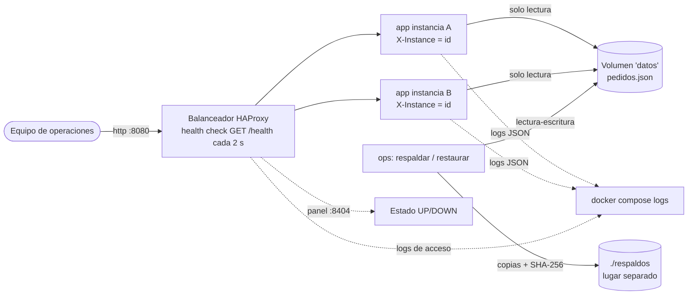

# Arquitectura del MVP

## Diagrama

## Componentes y por qué existen

| Componente | Requisito del reto que cubre | Dónde |
|---|---|---|
| 2+ instancias idénticas de la app | Dos instancias del servicio | `docker-compose.yml` (`app`, `deploy.replicas`) |
| Balanceador HAProxy | Punto de acceso común, distribución de solicitudes | `haproxy/haproxy.cfg` |
| `GET /health` + `check` de HAProxy + `HEALTHCHECK` | Forma de comprobar la salud | `app/app.py`, `haproxy.cfg`, compose |
| Cabecera/campo `X-Instance` / `instancia` | Reconocer qué instancia atendió | `app/app.py` |
| Logs JSON de la app + logs de acceso de HAProxy + panel `/stats` | Consultar registros | `docker compose logs`, `:8404/stats` |
| Volumen `datos` (solo lectura para apps) | Datos fuera del almacenamiento efímero | `docker-compose.yml` |
| `init-datos` (idempotente) | Datos iniciales sin pisar los existentes | `docker-compose.yml` |
| `ops.sh` + carpeta `respaldos/` | Respaldo y restauración definidos | `scripts/ops.sh` |
| `pruebas.py` | Pruebas repetibles + evidencias + tiempos | `scripts/pruebas.py` |
| GitHub Actions | Reproducibilidad y prueba continua | `.github/workflows/ci.yml` |

## Flujo de una solicitud

1. El usuario llama a `localhost:8080/pedidos`.
2. HAProxy elige la siguiente instancia **sana** (roundrobin).
3. La instancia lee `/data/pedidos.json` (volumen), responde con `instancia` y `version_datos` y registra la solicitud.
4. Si la instancia elegida no responde, HAProxy **reintenta** la solicitud en otra (`retries 3` + `option redispatch`) y, tras 2 fallos de
   salud seguidos (~4 s), la saca de la rotación.

## Decisiones de diseño (y alternativas descartadas)

| Decisión | Motivo | Alternativa y por qué no |
|---|---|---|
| **HAProxy** como balanceador | Comprobación de salud **activa** incluida, descubrimiento por DNS de Docker (permite escalar sin editar configuración), logs claros | Nginx: en su versión libre solo tiene comprobación pasiva y resuelve nombres una vez al arrancar |
| **Docker Compose** (no Kubernetes) | Cabe en 2 h, el reto no exige un orquestador concreto | Kubernetes/Swarm: más potentes, pero curva de aprendizaje y tiempo |
| **App con solo biblioteca estándar** | Cero dependencias, imagen mínima, nada que "se rompa" al instalar | Flask: válido, pero añade dependencias sin aportar al objetivo |
| Datos leídos en cada solicitud | Alteraciones y restauraciones se ven al instante, sin reiniciar | Caché en memoria: más rápido, pero oculta el efecto de la restauración |
| Apps con volumen **solo lectura** | Una app comprometida o con errores no puede dañar los datos | Escritura compartida: requiere control de concurrencia (fuera del alcance) |
| Respaldo en carpeta **separada** con hash | "Mantener el respaldo fuera de la copia que se modifica" y verificar integridad | Respaldar dentro del mismo volumen: se perdería junto con los datos |
| Restauración **atómica** (`cp` + `mv`) | Nunca se sirve un archivo a medias | Copia directa: ventana de datos corruptos |

## Qué NO incluye (a propósito)

Multirregión, base de datos distribuida, escritura concurrente, autenticación de usuarios, TLS. Ver [`LIMITACIONES.md`](LIMITACIONES.md).
