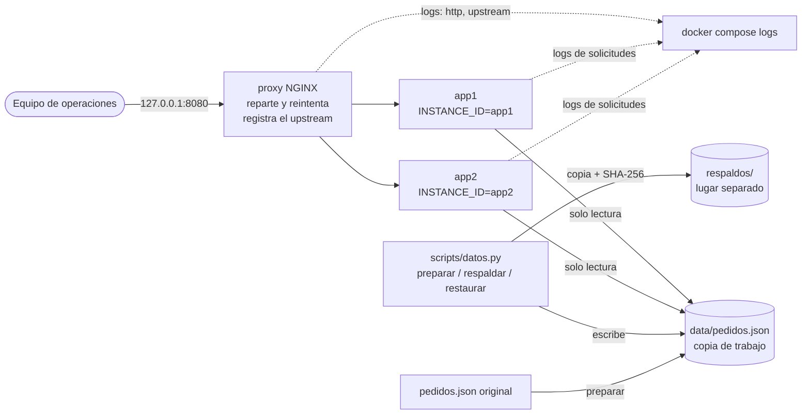

# Arquitectura del MVP

**Puntos únicos de fallo (declarados):** el computador, el proxy y el archivo de datos compartido. Mejora propuesta: ver `LIMITACIONES.md`.

## Componentes y requisito que cubren

| Componente | Requisito | Dónde |
|---|---|---|
| `app1`, `app2` | Dos instancias del servicio | `compose.yaml` |
| `proxy` NGINX | Punto de acceso común, distribución, reintentos | `proxy/nginx.conf` |
| `/health` + healthcheck de Docker | Forma de comprobar la salud | `app.py`, `compose.yaml` |
| Campo `instancia` + log del proxy (`upstream=`) | Saber qué instancia atendió | `app.py`, `nginx.conf` |
| `docker compose logs` | Consultar registros | - |
| `data/pedidos.json` montado | Datos fuera del almacenamiento efímero | `compose.yaml` |
| `datos.py respaldar/restaurar` + `respaldos/` | Respaldo y restauración definidos, con integridad | `scripts/datos.py` |
| `verificar_servicio.py` + `pruebas_automaticas.py` | Pruebas repetibles y evidencia | `scripts/` |
| GitHub Actions | Reproducibilidad | `.github/workflows/ci.yml` |

## Flujo de una consulta

1. El usuario llama `http://127.0.0.1:8080/pedidos`.
2. NGINX elige la siguiente instancia (round robin) y le reenvía la consulta.
3. La instancia lee `/data/pedidos.json`, responde con `instancia` y la versión y registra código HTTP en consola.
4. Si la instancia no responde (error de conexión o demora), NGINX **reintenta** con la otra; el usuario normalmente no lo nota.

## Qué NO incluye (a propósito)

Multirregión, base de datos distribuida, escritura concurrente, HTTPS, autenticación de usuarios. Ver [`LIMITACIONES.md`](LIMITACIONES.md).
