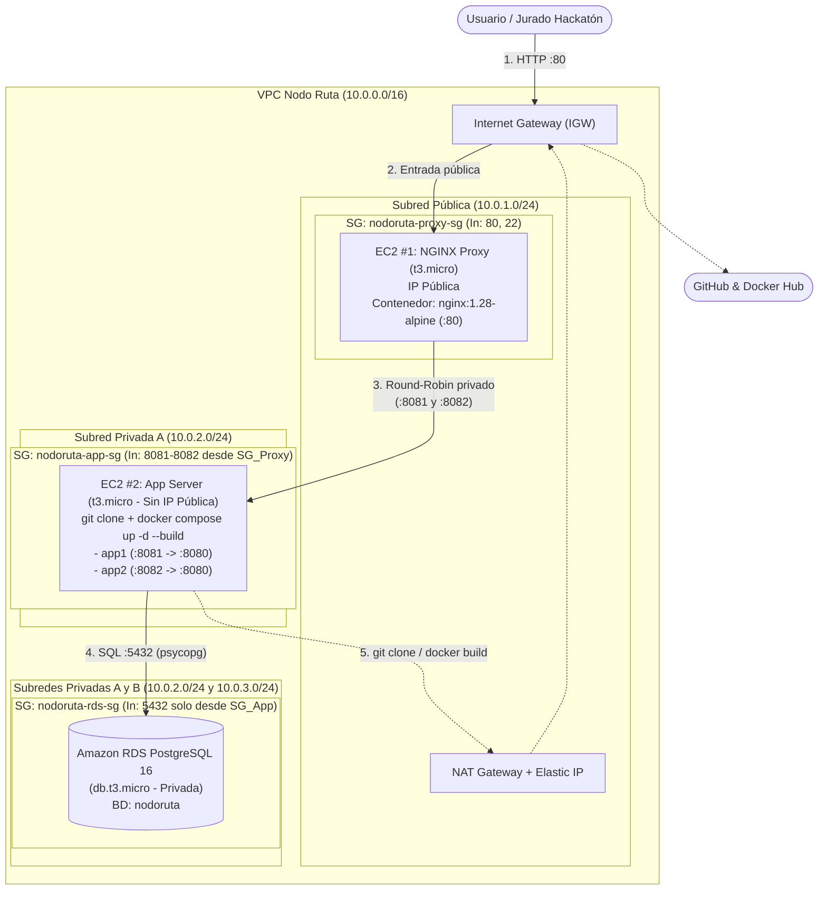
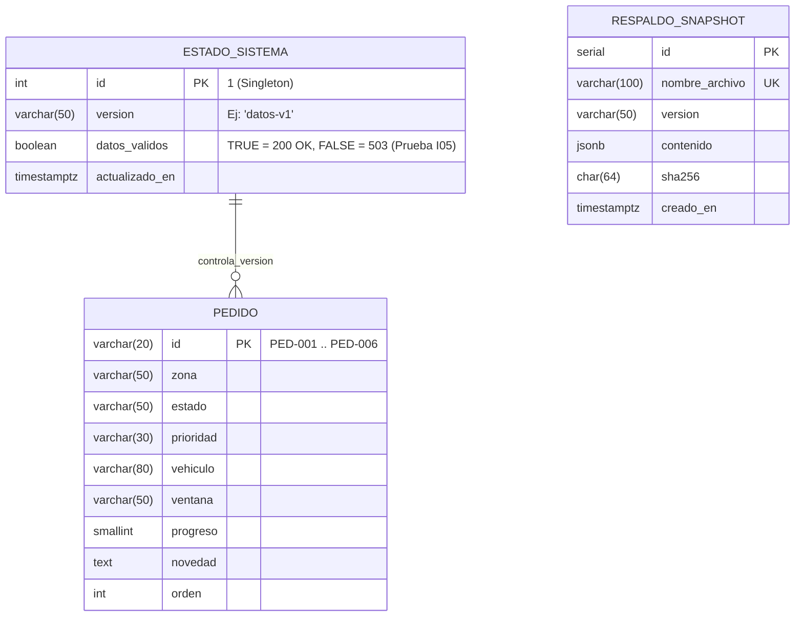

# Guía de Despliegue en AWS para la Hackatón (2 EC2 + RDS PostgreSQL + VPC + NAT Gateway)

Esta guía resume todo lo que necesitan para levantar la arquitectura en **menos de 15 minutos** durante la hackatón, ya sea con **Terraform (IaC)** o con el **script de comandos AWS CLI en CloudShell** como contingencia.

---

## 1. Arquitectura Desplegada



---

## 2. Modelo Entidad-Relación en RDS PostgreSQL

La migración desde el sistema antiguo (`pedidos.json`) crea automáticamente tres tablas en RDS PostgreSQL:



---

## 3. Credenciales y Requisitos Previos

Antes de empezar a correr los comandos en AWS, asegúrate de tener:

1. **Repositorio en GitHub Público con estos últimos cambios subidos (`git push`)**:
   - Porque la **EC2 #2 (en la Subred Privada)** sale a internet por el **NAT Gateway** y ejecuta:
     `git clone https://github.com/<TU_USUARIO>/<TU_REPO>.git` y luego `docker compose -f compose.aws.yaml up -d --build`.
2. **Sesión abierta en la Consola de AWS (CloudShell)**:
   - En **AWS CloudShell** (el ícono `>_` arriba a la derecha en la consola de AWS) **NO necesitas configurar `aws configure`**, porque CloudShell ya tiene tus credenciales cargadas automáticamente.
   - Si en cambio corres Terraform desde tu PC local, debes exportar:
     ```bash
     export AWS_ACCESS_KEY_ID="TU_ACCESS_KEY"
     export AWS_SECRET_ACCESS_KEY="TU_SECRET_KEY"
     export AWS_SESSION_TOKEN="TU_SESSION_TOKEN" # Solo si usas AWS Academy / cuenta educativa
     ```
3. **Contraseña para RDS PostgreSQL (`DB_PASSWORD`)**:
   - Mínimo 8 caracteres alfanuméricos, por ejemplo: `NodoRuta2026*`.

---

## 4. Opción A (Recomendada): Despliegue con Terraform en AWS CloudShell

Abre **AWS CloudShell** en tu navegador y pega estos bloques:

```bash
# 1. Instalar Terraform en AWS CloudShell (tarda ~10 segundos)
sudo yum install -y yum-utils
sudo yum-config-manager --add-repo https://rpm.releases.hashicorp.com/AmazonLinux/hashicorp.repo
sudo yum -y install terraform

# 2. Clonar tu repositorio en CloudShell (rama dev o main)
git clone --branch dev https://github.com/<TU_USUARIO>/<TU_REPO>.git || git clone https://github.com/<TU_USUARIO>/<TU_REPO>.git
cd <TU_REPO>/infra

# 3. Inicializar y aplicar Terraform
terraform init
terraform apply -auto-approve \
  -var="git_repo_url=https://github.com/<TU_USUARIO>/<TU_REPO>.git" \
  -var="git_branch=dev" \
  -var="db_password=NodoRuta2026*"
```

Al terminar (tarda ~7-9 minutos por la creación de RDS y NAT Gateway), Terraform imprimirá:
- `service_url_panel = "http://<IP_PUBLICA_PROXY>/panel"`
- `service_url_pedidos = "http://<IP_PUBLICA_PROXY>/pedidos"`
- `service_url_health = "http://<IP_PUBLICA_PROXY>/health"`

*(Espera ~90 segundos tras terminar `terraform apply` mientras la EC2 privada descarga e instala los contenedores vía NAT Gateway).*

---

## 5. Opción B (Contingencia): Script de Comandos AWS CLI en CloudShell (Sin Terraform)

Si Terraform falla o prefieren ejecutar directamente los comandos de AWS CLI (`aws ec2` y `aws rds`), abre **AWS CloudShell** y ejecuta:

```bash
# 1. Clonar tu repositorio en CloudShell (rama dev o main)
git clone --branch dev https://github.com/<TU_USUARIO>/<TU_REPO>.git || git clone https://github.com/<TU_USUARIO>/<TU_REPO>.git
cd <TU_REPO>

# 2. Definir la URL de tu repositorio y contraseña de RDS
export GIT_REPO_URL="https://github.com/<TU_USUARIO>/<TU_REPO>.git"
export GIT_BRANCH="dev"
export DB_PASSWORD="NodoRuta2026*"

# 3. Ejecutar el despliegue automatizado por comandos de AWS CLI
bash scripts/deploy_cloudshell.sh
```

---

## 6. Limpieza al Terminar la Hackatón (Evitar Costos)

- **Si desplegaste con Terraform**:
  ```bash
  cd infra
  terraform destroy -auto-approve \
    -var="git_repo_url=https://github.com/<TU_USUARIO>/<TU_REPO>.git" \
    -var="db_password=NodoRuta2026*"
  ```
- **Si desplegaste con el script de CloudShell**:
  ```bash
  bash scripts/destroy_cloudshell.sh
  ```
